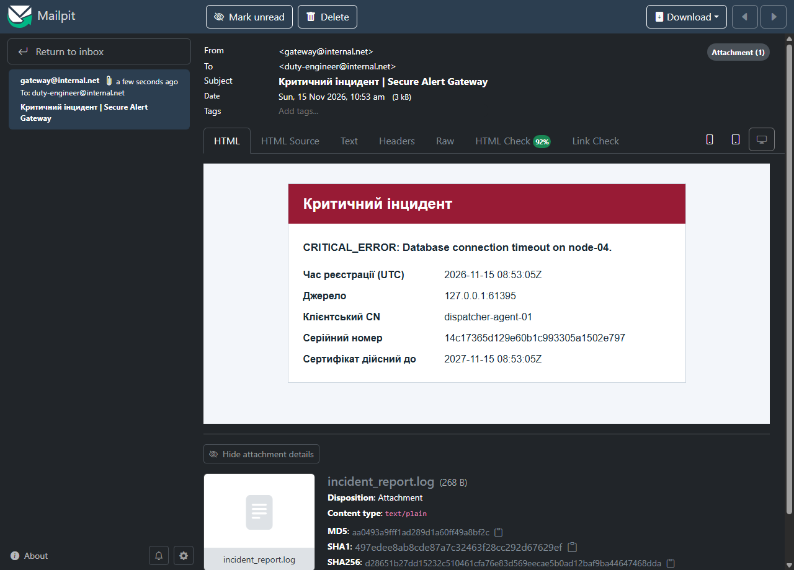

# Практична робота № 3. Захищений канал mTLS і SMTP

Secure Alert Gateway приймає повідомлення про інцидент через TCP з взаємною автентифікацією TLS 1.3. Шлюз бере ідентифікатор клієнта з перевіреного сертифіката, записує дані аудиту й надсилає HTML-сповіщення з вкладенням `incident_report.log` через SMTP з обов’язковим STARTTLS.

## Запуск у PowerShell

Потрібні Go 1.22 або новіший і [Mailpit для Windows](https://github.com/axllent/mailpit/releases/latest). Розпакуй `mailpit.exe` та запускай усі команди з кореня проєкту.

1. Якщо папка `certs` відсутня, створи локальний CA, серверний і клієнтський сертифікати.

   ```powershell
   go run ./cmd/gencerts
   ```

   Ту саму команду виконує `./generate_certs.ps1`. Генератор відмовляється перезаписувати наявний каталог. Папка `certs/` і приватні ключі виключені з Git.

2. У першому терміналі запусти Mailpit. Укажи шлях до розпакованого `mailpit.exe`, якщо він відсутній у `PATH`.

   ```powershell
   mailpit.exe --listen 127.0.0.1:8025 --smtp 127.0.0.1:1025 --smtp-tls-cert certs/server.crt --smtp-tls-key certs/server.key --smtp-require-starttls
   ```

3. У другому терміналі запусти шлюз. За замовчуванням він слухає `127.0.0.1:8443` і передає пошту локальному Mailpit на `127.0.0.1:1025`.

   ```powershell
   go run ./server
   ```

4. У третьому терміналі надішли тестове сповіщення.

   ```powershell
   go run ./client
   ```

   Клієнт отримає `[SERVER]: ALERT PROCESSED AND DISPATCHED` після підтвердження приймання листа SMTP-сервером. Відкрий [Mailpit](http://127.0.0.1:8025), обери лист для `duty-engineer@internal.net` і завантаж `incident_report.log`.

## Демонстрація mTLS

```powershell
go run ./client -no-cert
```

Сервер відхилить TLS-з’єднання, а клієнт завершиться з помилкою. Для демонстрації першого рівня запусти шлюз із `go run ./server -mtls-only`. Клієнт із дійсним сертифікатом отримає `[SERVER]: ALERT RECEIVED AND VERIFIED`.

Окрему подію можна передати параметром `-message`. Клієнт надсилає один рядок UTF-8 до 4096 байтів, завершений символом нового рядка. Якщо SMTP недоступний або перевірка STARTTLS завершується помилкою, шлюз журналює причину й повертає `[SERVER]: ALERT VERIFIED, EMAIL FAILED`.

## Конфігурація і структура

- `cmd/gencerts` і `internal/pki` створюють ECDSA P-256 ключі, CA та сертифікати X.509. У серверному сертифікаті є SAN `localhost`, `127.0.0.1` і `::1` та призначення `ServerAuth`. У клієнтському задано `CN=dispatcher-agent-01` і `ClientAuth`.
- `server` слухає TCP через `tls.Listen` з `RequireAndVerifyClientCert`. `internal/gateway` витягає CN, серійний номер і строк дії з перевіреного сертифіката, читає інцидент, веде аудит і повертає підтвердження. `client` перевіряє CA та адресу сервера, надсилає інцидент і читає відповідь.
- `internal/notification` формує `multipart/mixed` із HTML та Base64-вкладенням. Текст інциденту екранується в HTML. `net/smtp` надсилає лист після STARTTLS і перевірки сертифіката поштового сервера.
- Параметри `-smtp`, `-smtp-ca`, `-from` і `-to` доступні на сервері. Для SMTP за адресою loopback типовий довірений CA береться з `certs/ca.crt`, для інших вузлів використовуються системні корені. `-smtp-ca` дозволяє вказати окремий PEM-файл. Для SMTP з PLAIN-автентифікацією використовуються `SMTP_USERNAME` і `SMTP_PASSWORD`, і лише після успішного STARTTLS.

## Результати перевірки

Перевірено сім сценаріїв через реальні локальні TCP-з’єднання. Шлюз підтвердив подію в режимі `-mtls-only` і доставив один лист у Mailpit із STARTTLS. Відхилено клієнта без сертифіката та клієнта із сертифікатом стороннього CA. Клієнт також відмовився довіряти серверу з невідомим CA. SMTP-відправлення припинилося, коли поштовий сервер не пропонував STARTTLS або мав недовірений сертифікат.

Переглянуто HTML у Mailpit і завантажено `incident_report.log`. У ньому є повідомлення, CN, серійний номер та час події. Тести й збірка пройшли через `go test -count=3 ./...`, `go vet ./...` і `go build ./...`.



- [Фактичний вивід шлюзу та клієнта](docs/screenshots/mtls-smtp.png)
- [Завантажений журнал інциденту](docs/screenshots/attachment.png)

[Відповіді на контрольні запитання](answers/).
